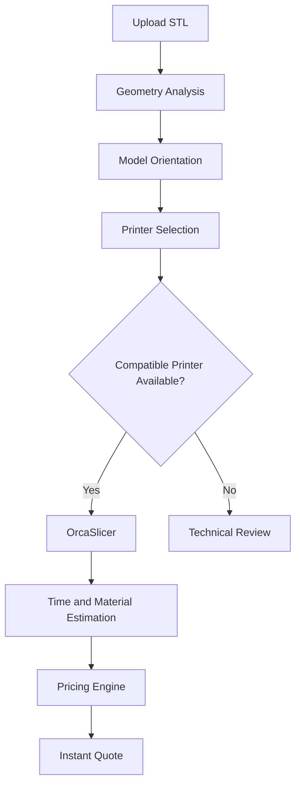
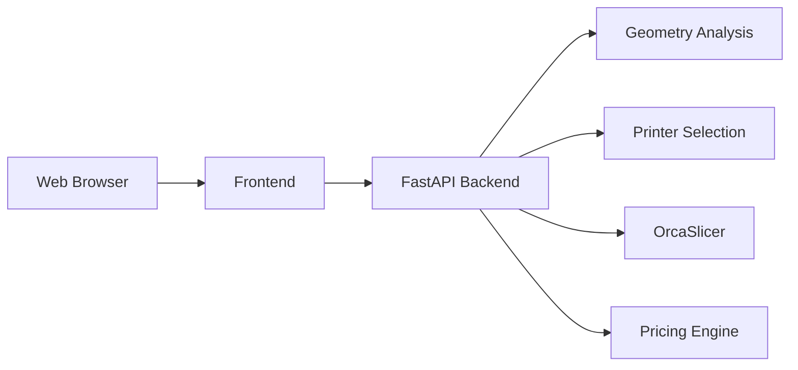

# My-Instant 3D Quote


**An open-source, self-hosted instant quotation platform for 3D printing services.**

Developed by [MyMachines](https://my-machines.com).

## Overview

My-Instant 3D Quote is a web-based application designed to automate the quotation process for FDM 3D printing services.

Customers can upload a 3D model, inspect its geometry, define printing parameters, and receive an instant price estimate based on actual slicing data and configurable production costs.

The project aims to make professional 3D printing quotation tools accessible to makers, small workshops, print farms, and manufacturing businesses.

## Features

- STL file upload and geometry analysis
- Interactive 3D model visualization
- Manual model orientation
- Lay-on-face orientation
- Automatic printer selection
- Printer build volume validation
- Alternative printer selection based on availability
- Configurable materials and print quality profiles
- OrcaSlicer CLI integration
- Print time and filament consumption estimation
- Configurable production cost calculation
- Risk-adjusted pricing and commercial margins
- Minimum order value
- Separation of public pricing and internal production costs
- Docker-based deployment

## How It Works



## Technology Stack

| Component           | Technology                |
| ------------------- | ------------------------- |
| Frontend            | React, TypeScript, Vite   |
| 3D visualization    | Three.js                  |
| Backend             | Python, FastAPI           |
| Geometry processing | Trimesh                   |
| Slicing engine      | OrcaSlicer                |
| Web server          | Nginx                     |
| Deployment          | Docker and Docker Compose |

## Architecture



The frontend communicates with the backend through an HTTP API.

Internal production costs and pricing calculations remain on the backend. Only the necessary quotation information is returned to the customer.

## Getting Started

### Requirements

- Docker
- Docker Compose
- Git
- An AMD64 (x86-64) or ARM64 environment

### Installation

Clone the repository and enter the project directory.

```bash
git clone https://github.com/EdgarMata/mymachines-3d-quote.git
cd mymachines-3d-quote
```

Build and start the application:

```bash
docker compose up -d --build
```

Open the application in your browser:

```text
http://localhost:8080
```

The backend API documentation is available locally at:

```text
http://localhost:8000/docs
```

To stop the application:

```bash
docker compose down
```

## Configuration

The quotation engine uses configurable JSON files.

| File                        | Purpose                                       |
| --------------------------- | --------------------------------------------- |
| `config/printing.json`      | Printers, materials and print quality options |
| `config/pricing.json`       | General pricing parameters                    |
| `config/machine_costs.json` | Machine-specific production costs             |
| `profiles/`                 | Slicer configuration profiles                 |

The included cost parameters are illustrative and should be adapted to each business before commercial use.

Backend safety limits default to 50 MiB per STL, 1,000,000 input triangles and
1–100 units per automatic estimate. STL geometry and printing parameters are
validated before slicing. Heavy endpoints admit one request at a time by default,
returning 503 / Retry-After 5 when busy; OrcaSlicer has a 60-second deadline.
These process-local protections require a single Uvicorn worker. Open/non-watertight models with usable finite surface
are accepted, but may still need repair or technical review. See
[Architecture](docs/ARCHITECTURE.md) for the acceptance policy and
[Deployment](docs/DEPLOYMENT.md) for environment settings and proxy limits.
Normal request cleanup runs immediately after processing; recognized abandoned
directories become eligible for recovery after one hour, checked at startup and
every five minutes. Active locks prevent age-based deletion of running jobs. See
[Temporary storage](docs/TEMPORARY_STORAGE.md) for ownership, privacy and limits.

## Project Structure

```text
mymachines-3d-quote/
├── backend/
├── frontend/
├── config/
├── profiles/
├── docker/
├── docs/
├── tests/
├── docker-compose.yml
├── LICENSE
└── README.md
```

## Roadmap

### Core quotation engine

- [x] STL geometry analysis
- [x] OrcaSlicer integration
- [x] Automatic printer selection
- [x] Configurable pricing engine
- [x] Public quotation response

### Web application

- [x] Interactive 3D viewer
- [x] Manual model orientation
- [x] Lay-on-face orientation
- [x] Instant quotation interface
- [x] Docker Compose deployment
- [x] Automated build/test CI on AMD64 and ARM64
- [ ] Automated deployment
- [ ] Production deployment
- [ ] Improved error handling and resource management

### Business integration

- [ ] Customer identification
- [ ] Quotation history
- [ ] Odoo CRM integration
- [ ] Odoo Sales integration
- [ ] Customer portal
- [ ] Online orders and payments

### Future improvements

- [ ] Asynchronous slicing jobs
- [ ] Multiple model quotations
- [ ] Batch printing optimization
- [ ] Additional 3D file formats
- [ ] Extended material support
- [ ] Production scheduling integration

## Project Status

This project is currently under active development.

The core quotation workflow has been validated locally, including geometry analysis, printer selection, slicing, pricing, and browser-based quotation.

It is not yet considered production-ready.

Generated quotations are estimates and may require technical review before manufacturing. Slicing results are intended for quotation purposes, not as validated production G-code.

## Contributing

Contributions, ideas, bug reports, and technical discussions are welcome.

Please use GitHub Issues to report bugs or propose new features.

The project values simplicity, reliability, maintainability, and reproducibility.

## License

This project is licensed under the **GNU Affero General Public License v3.0 (AGPL-3.0)**.

See the [LICENSE](LICENSE) file for details.

Third-party software and dependencies remain subject to their respective licenses.

## Acknowledgements

This project builds upon the work of several open-source communities, including:

- [OrcaSlicer](https://github.com/OrcaSlicer/OrcaSlicer)
- [FastAPI](https://fastapi.tiangolo.com/)
- [Trimesh](https://trimesh.org/)
- [Three.js](https://threejs.org/)
- [React](https://react.dev/)
- [Vite](https://vite.dev/)

## About MyMachines

MyMachines develops open-source machines, software, and tools for digital manufacturing.

Our goal is to make manufacturing technology more accessible, understandable, repairable, and reliable.

**It simply works.**

[my-machines.com](https://my-machines.com)
